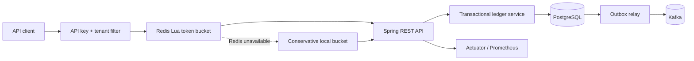

# LedgerGuard

LedgerGuard is a multi-tenant wallet ledger built to make the failure cases visible: duplicate requests, concurrent spending, partial event delivery, cross-tenant access, and rate-limit infrastructure outages.

It uses Java 25, Spring Boot 4, PostgreSQL, Redis, and Kafka. The core journal is double-entry and append-only; corrections are new reversal transactions, never edits to financial history.

## What this project demonstrates

- Double-entry validation in both Java and PostgreSQL
- Database-enforced tenant, currency, numeric-range, and negative-balance boundaries
- Database-sealed journal headers and entries with auditable reversals
- Transactional idempotency with request-hash conflict detection
- Deterministic `SELECT ... FOR UPDATE` locking and optimistic version checks
- Transactional outbox with Kafka retry, dead-lettering, requeue, and `SKIP LOCKED` claims
- Per-client Redis token bucket implemented as an atomic Lua script
- Conservative in-process rate-limit fallback when Redis is unavailable
- Tenant isolation from the API key through every repository query
- OpenAPI 3.1 contract, Prometheus metrics, unit/integration/E2E tests, and CI

## Run the complete stack

Requirements: Docker Compose and `curl`; the E2E script additionally uses `jq`.

```bash
docker compose up -d --build
curl http://localhost:8080/actuator/health/readiness
```

Docker Compose explicitly enables a development bootstrap that provisions one local-only client:

```text
X-API-Key: ledgerguard-dev-key
```

The bootstrap is disabled by default. Do not enable it outside a local demo. Production clients must be provisioned with a random secret; only its SHA-256 digest is stored.

The OpenAPI contract is available at [src/main/resources/static/openapi.yaml](src/main/resources/static/openapi.yaml) and, while the service is running, at `http://localhost:8080/openapi.yaml`.

## Post a transaction

Create one asset account and one liability account:

```bash
curl -sS -H 'X-API-Key: ledgerguard-dev-key' \
  -H 'Content-Type: application/json' \
  -d '{"externalId":"settlement-usd","currency":"USD","accountType":"ASSET","allowNegative":true}' \
  http://localhost:8080/v1/accounts

curl -sS -H 'X-API-Key: ledgerguard-dev-key' \
  -H 'Content-Type: application/json' \
  -d '{"externalId":"wallet-kevin","currency":"USD","accountType":"LIABILITY","allowNegative":false}' \
  http://localhost:8080/v1/accounts
```

Use the returned IDs to post a balanced deposit:

```bash
curl -i -H 'X-API-Key: ledgerguard-dev-key' \
  -H 'Idempotency-Key: deposit-20260809-001' \
  -H 'Content-Type: application/json' \
  -d '{
    "externalReference":"processor-12345",
    "transactionType":"DEPOSIT",
    "entries":[
      {"accountId":"ASSET_ACCOUNT_UUID","side":"DEBIT","amount":100.00},
      {"accountId":"WALLET_ACCOUNT_UUID","side":"CREDIT","amount":100.00}
    ]
  }' \
  http://localhost:8080/v1/transactions
```

Repeating the exact request returns the original resource and `Idempotent-Replayed: true`. Reusing the key with a changed request returns `409 idempotency_key_reused`.

## Architecture



The posting transaction atomically claims the idempotency key, locks all accounts in UUID order, creates a draft journal, inserts and seals its entries, updates balance projections, inserts an outbox event, and stores the replay response. A deferred database trigger rejects any draft that reaches commit, and posted headers and entries cannot be mutated. Any failure rolls all of it back. A transaction accepts 2–100 entries, and monetary values must fit PostgreSQL `NUMERIC(30, 8)` without rounding.

See [architecture.md](docs/architecture.md) for the posting sequence and [design-decisions.md](docs/design-decisions.md) for explicit trade-offs.

## Tests

With Java 25 and Maven installed:

```bash
mvn verify
```

Testcontainers runs PostgreSQL concurrency/invariant and multi-instance Redis atomicity tests when Docker is available, and skips them otherwise. The full black-box path is:

```bash
docker compose up -d --build
./scripts/e2e.sh
```

The E2E test verifies account creation, balanced posting, exact idempotent replay, projected balance, and rejection of an unbalanced journal.

## Benchmark

The JMH benchmark isolates in-memory ledger validation from database and network latency:

```bash
mvn -Pbenchmark test-compile exec:exec
```

Results must be compared on the same machine and JVM. The benchmark deliberately does not claim end-to-end transaction throughput; PostgreSQL lock contention and storage latency dominate that measurement. See [benchmark.md](docs/benchmark.md).

## Operational endpoints

- `/actuator/health/liveness`
- `/actuator/health/readiness`
- `/actuator/prometheus`

Rate-limit metrics include `ledgerguard_rate_limit_decisions_total`, `ledgerguard_rate_limit_fallback_total`, and `ledgerguard_rate_limit_redis_errors_total`. Outbox results are exposed through `ledgerguard_outbox_events_total`; `ledgerguard_outbox_oldest_unpublished_age_seconds` reports pending-event age.

## Scope and limitations

This is a rigorous portfolio-sized ledger, not a complete regulated banking platform. Before real-money use it would still need key-management integration, administrative account lifecycle APIs, data-retention policy, backup/restore drills, ledger-to-source reconciliation workflows, authorization roles, compliance controls, and multi-region recovery design.

## Documentation

- [Architecture](docs/architecture.md)
- [Design decisions and trade-offs](docs/design-decisions.md)
- [Operations and failure modes](docs/operations.md)
- [Benchmark methodology](docs/benchmark.md)
- [Security policy](SECURITY.md)
- [Changelog](CHANGELOG.md)

## License

MIT
